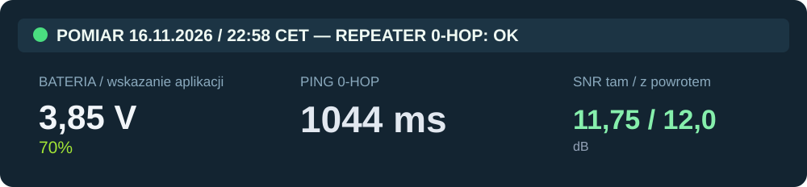

<a href="README.md">🇵🇱 Polski</a> · <strong>🇬🇧 English</strong>

# A solar wall lamp turned into a MeshCore repeater

A compact 868 MHz MeshCore repeater built around **Seeed XIAO nRF52840 + Wio-SX1262**. The enclosure and **1 W solar panel** were repurposed from a small outdoor wall lamp. The antenna coaxial feed-through uses an existing wall-mount screw hole rather than a newly drilled hole.

 &nbsp; 

This is an **operational prototype**, not a proven unattended winter installation. The modified firmware supports **RXPS Balanced level 6, 16-symbol preamble**; a successful direct 0-hop ping and administrator connection were verified on iPhone.

| Specification | Current state |
|:--|:--|
| Radio | 869.618 MHz / SF8 / BW62.5 kHz / CR8 |
| Firmware | MeshCore 1.18.0-derived RXPS Balanced level 6 |
| RXPS timing | 49.329 ms receive / 23.757 ms sleep; not a current measurement |
| Solar | Original 1 W panel |
| Battery | Single 18650 during initial testing; protected 1S2P under consideration |
| Antenna | External coax + SMA connection through former mounting hole |
| Verified radio test | 16 Nov 2026, 22:58 CET: 0-hop ping 1044 ms, SNR 11.75/12.0 dB |
| Battery snapshot | 3.85 V / 70% reported, not a capacity measurement |

**Documentation:** [Hardware](docs/hardware-en.md) · [Firmware](docs/firmware-en.md) · [Power budget](docs/power-budget-en.md) · [Test log](docs/measurements-en.md) · [Gallery](docs/gallery-en.md) · [Safety](docs/safety-en.md).

**Next tests:** 7–14 days of solar autonomy, packet reception statistics, charging efficiency, low-temperature charge protection, weather sealing and possible second cell.

The pass-through reduces drilling but is **not evidence of waterproofing**. Li-ion cells require correct protection and charging. No claim is made that the 1 W panel guarantees a positive winter energy balance or that RXPS has zero packet loss.

Software upstream: [MeshCore](https://github.com/meshcore-dev/MeshCore).
