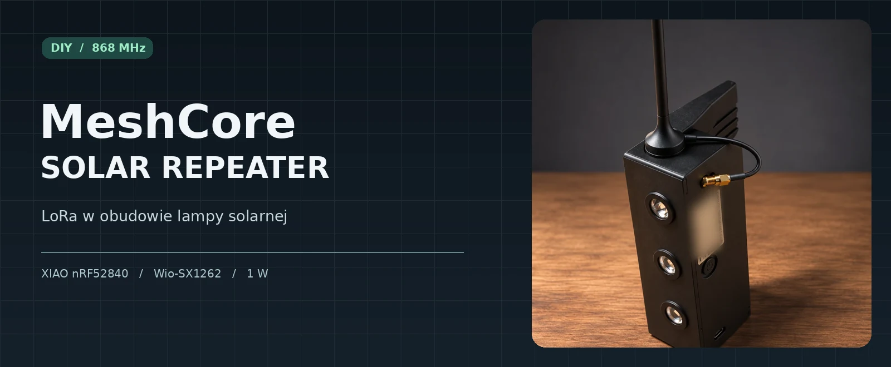
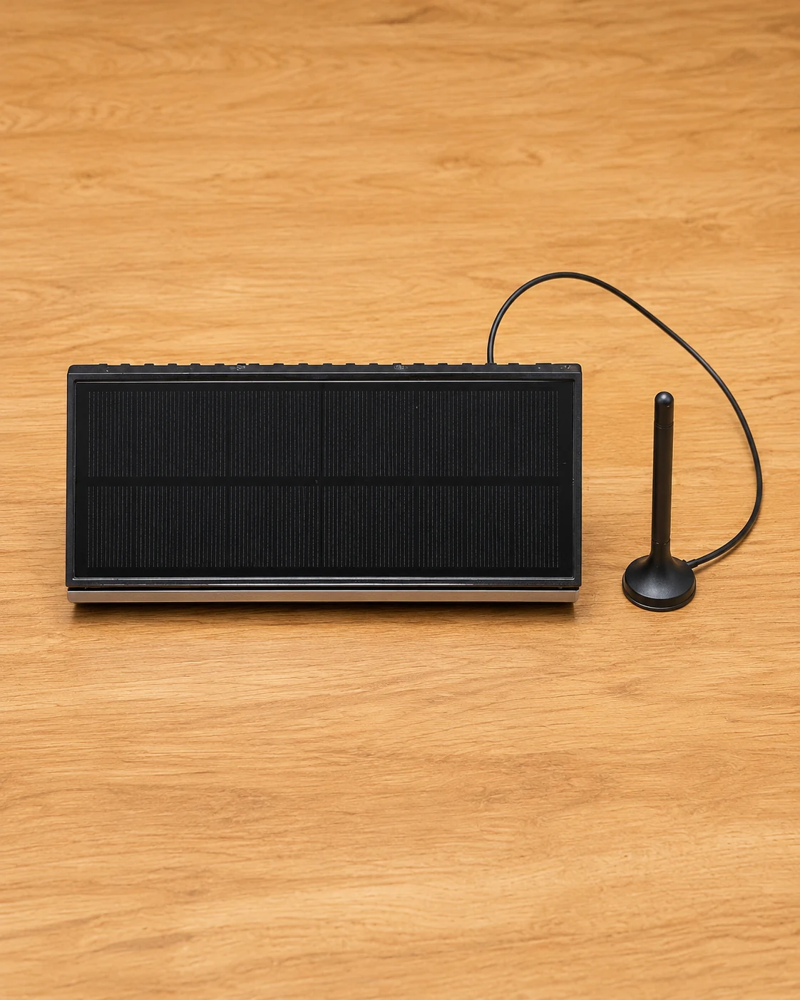
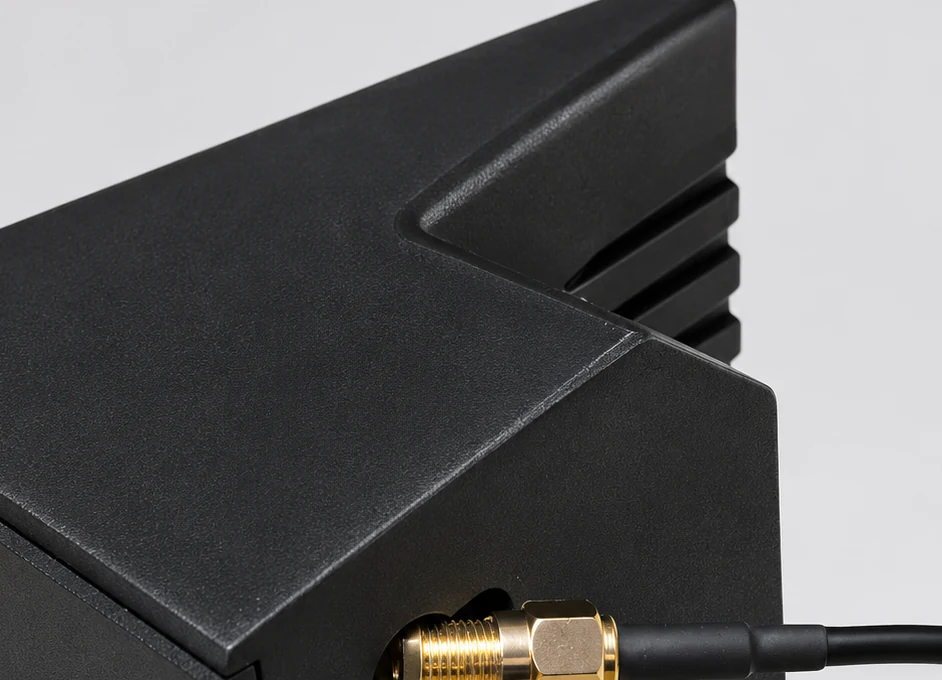

<a href="README.md">Polski</a> · <strong>English</strong> · <a href="docs/gallery-en.md">Gallery</a> · <a href="docs/measurements-en.md">Measurements</a>

# MeshCore Solar Repeater

**An 868 MHz LoRa repeater built into a compact solar wall-lamp enclosure.**

Rather than making another custom box, I reused a small wall lamp: its solar panel, space for an 18650 cell and unobtrusive housing. A Seeed XIAO board with an SX1262 LoRa module handles the radio, while the antenna connects externally.

## Build

<table>
<tr>
<td width="50%"> Enclosure and antenna cable</td>
<td width="50%"> Solar panel and external antenna</td>
</tr>
</table>

The enclosure retains its **nominal 1 W solar panel**. The external antenna cable uses an existing mounting screw hole in the lamp housing; no additional hole was needed at that location.

### Antenna connection

An external SMA connection makes it easier to choose an antenna and mounting position without reopening the enclosure.

### Inside

The enclosure accommodates an 18650 cell, electronics and antenna feed-through. Final fixing, insulation and cable protection are still on the work list before outdoor deployment.

[View the full gallery](docs/gallery-en.md)

## Specifications

| Component | Configuration |
|:--|:--|
| Microcontroller | Seeed XIAO nRF52840 |
| LoRa radio | Wio-SX1262 |
| Band | 868 MHz |
| Set frequency | 869.618 MHz |
| LoRa settings | SF8 · BW 62.5 kHz · CR8 |
| Firmware | MeshCore 1.18.0-derived |
| Power saving | RXPS Balanced level 6 |
| Panel | 1 W (nominal) |
| Prototype battery | 1 × 18650 |
| Antenna | External, SMA cable |

## First link test

Measurements from **16 November 2026, 22:58 CET**:

| Reading | Value |
|:--|--:|
| Link | Direct, 0 hops |
| Ping | 1044 ms |
| SNR | 11.75 / 12.0 dB |
| Battery voltage | 3.85 V |
| App-reported battery | 70% |

The repeater answered a direct ping. This establishes an initial working radio link, **not yet solar autonomy from the 1 W panel**. Current measurements and longer outdoor testing are still required.

## Work log

- [x] Start MeshCore and connect from a phone
- [x] Route external antenna through the housing
- [x] First ping and SNR check
- [ ] Protect cables and seal the SMA feed-through
- [ ] Measure current and log 7–14 days of charging
- [ ] Outdoor range and packet reception tests
- [ ] Verify safe Li-ion charging in low temperatures

## Technical notes

[Hardware](docs/hardware-en.md) · [Firmware](docs/firmware-en.md) · [Power budget](docs/power-budget-en.md) · [Measurements](docs/measurements-en.md) · [Gallery](docs/gallery-en.md) · [Safety](docs/safety-en.md)

Built with the open-source [MeshCore](https://github.com/meshcore-dev/MeshCore) firmware. Independent DIY hardware project.
