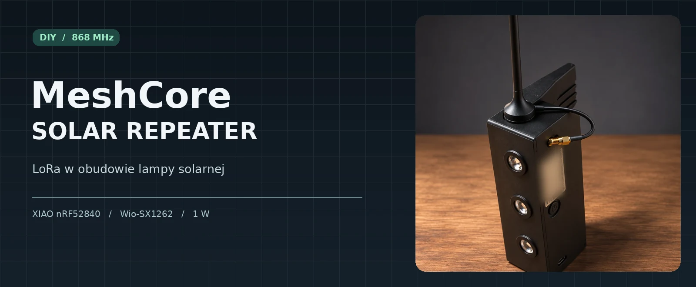
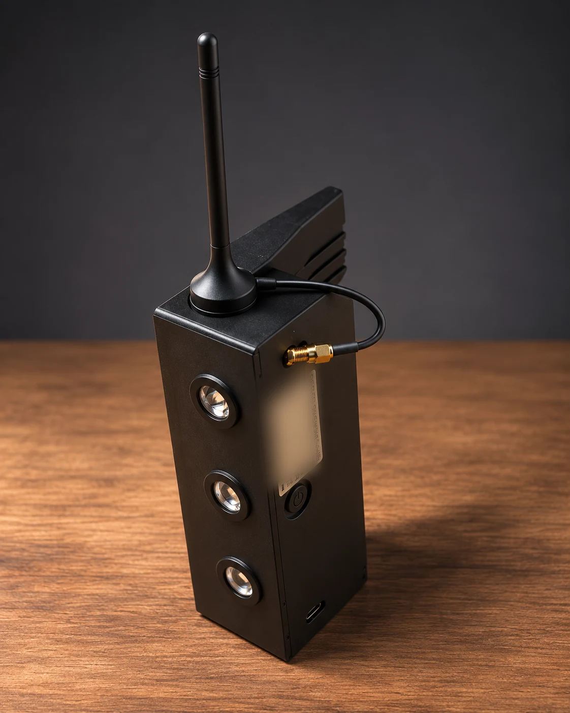
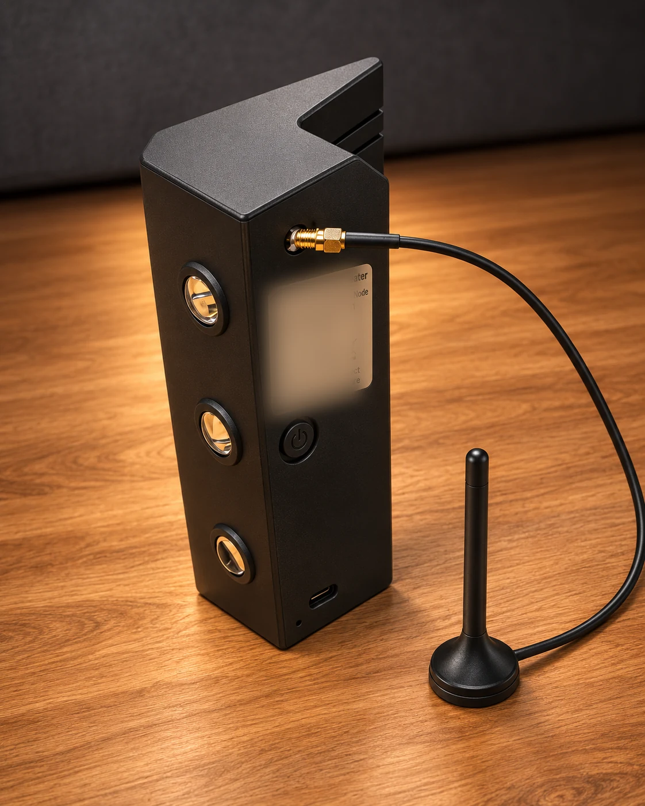
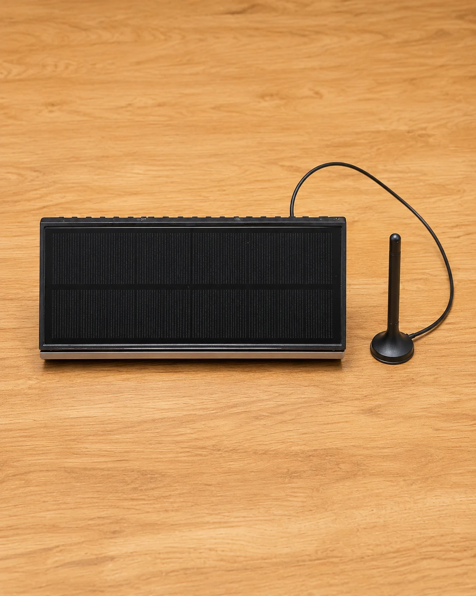
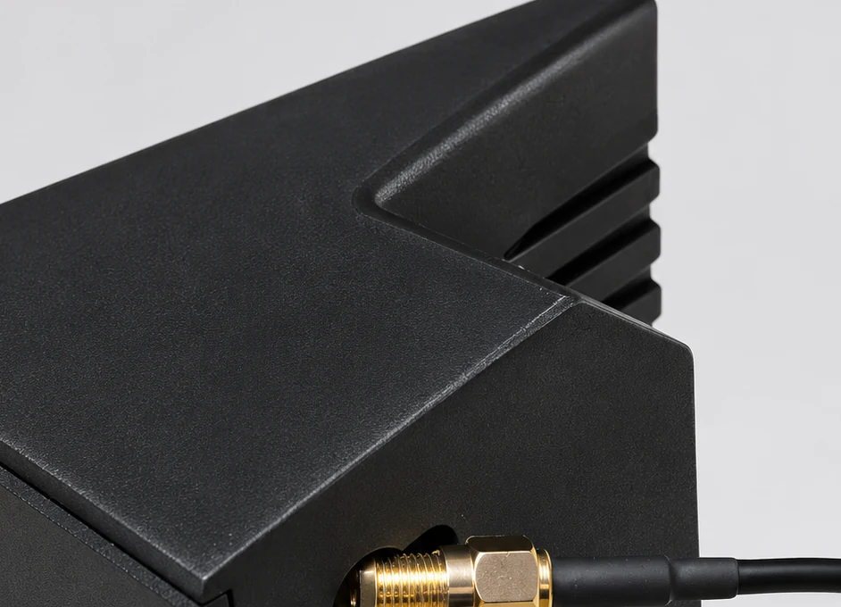
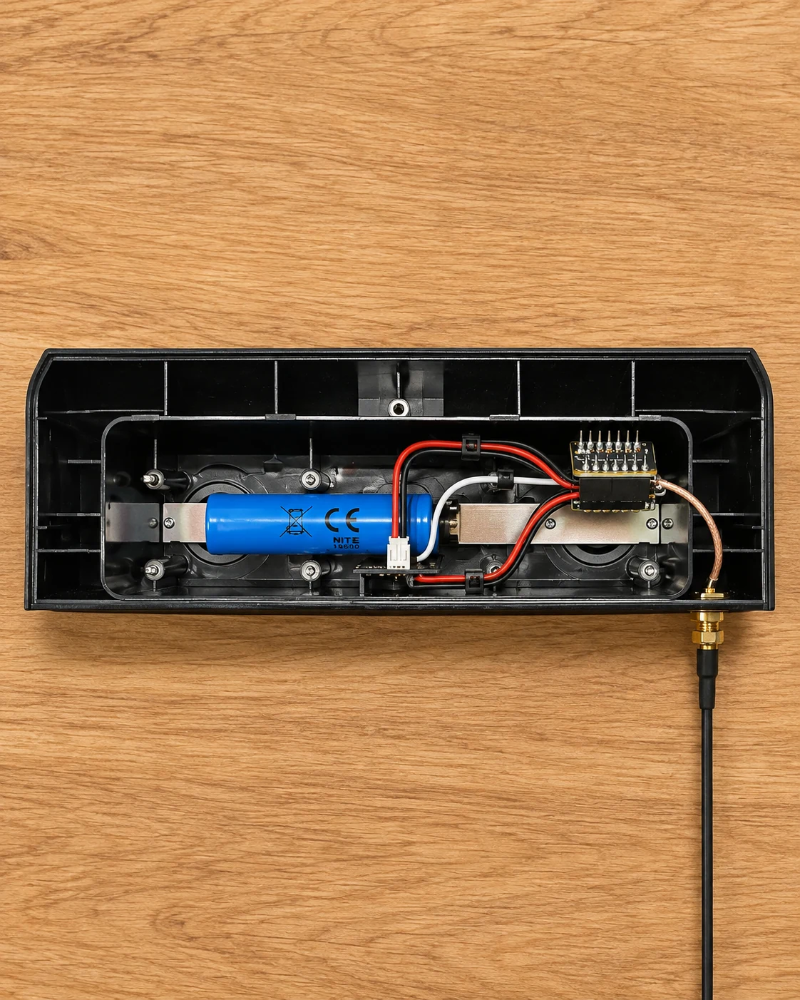

<strong>Polski</strong> · <a href="README.en.md">English</a> · <a href="docs/gallery-pl.md">Galeria</a> · <a href="docs/measurements-pl.md">Pomiary</a>

# MeshCore Solar Repeater

**Repetytor LoRa 868 MHz zamknięty w obudowie niedużej lampy solarnej.**

Zamiast projektować kolejną skrzynkę, wykorzystałem gotową lampę ścienną: panel solarny, miejsce na ogniwo 18650 i obudowę, która nie rzuca się w oczy. Do środka trafił zestaw Seeed XIAO z radiem SX1262. Antena została wyprowadzona na zewnątrz.

## Budowa

<table>
<tr>
<td width="50%"> Obudowa i przewód antenowy</td>
<td width="50%"> Panel solarny i antena zewnętrzna</td>
</tr>
</table>

Panel o deklarowanej mocy **1 W** jest częścią obudowy. Przewód antenowy przechodzi przez istniejący otwór po śrubie montażowej lampy — bez wykonywania dodatkowego otworu w tym miejscu.

### Złącze anteny

Zewnętrzne złącze SMA pozwala dobrać antenę i jej miejsce montażu bez otwierania obudowy.

### Wnętrze

Wewnątrz przewidziano miejsce na ogniwo 18650, elektronikę i przewód antenowy. Przed montażem na zewnątrz pozostają do dopracowania mocowanie, izolacja i zabezpieczenie przewodów.

[Pełna galeria zdjęć](docs/gallery-pl.md)

## Specyfikacja

| Element | Konfiguracja |
|:--|:--|
| Mikrokontroler | Seeed XIAO nRF52840 |
| Radio | Wio-SX1262 |
| Pasmo | 868 MHz |
| Ustawiona częstotliwość | 869,618 MHz |
| Parametry LoRa | SF8 · BW 62,5 kHz · CR8 |
| Firmware | MeshCore na bazie 1.18.0 |
| Profil oszczędzania | RXPS Balanced, poziom 6 |
| Panel | 1 W (moc deklarowana) |
| Zasilanie prototypu | 1 × 18650 |
| Antena | Zewnętrzna, przewód SMA |

## Test łączności

Pierwsze odczyty z **16 listopada 2026, godz. 22:58**:

| Pomiar | Wynik |
|:--|--:|
| Połączenie | Bezpośrednie, 0 hop |
| Ping | 1044 ms |
| SNR | 11,75 / 12,0 dB |
| Napięcie akumulatora | 3,85 V |
| Poziom wskazywany przez aplikację | 70% |

Repeater odpowiedział na ping. To potwierdza działające połączenie radiowe, ale **nie potwierdza jeszcze autonomii energetycznej panelu 1 W**. Potrzebne są pomiary zużycia energii i dłuższy test w terenie.

## Dziennik prac

- [x] Uruchomienie MeshCore i połączenia z telefonu
- [x] Wyprowadzenie anteny przez obudowę
- [x] Pierwszy test pingu i SNR
- [ ] Zabezpieczenie okablowania i uszczelnienie przejścia SMA
- [ ] Pomiar prądu i 7–14 dni obserwacji ładowania
- [ ] Testy terenowe, zasięg, skuteczność odbioru pakietów
- [ ] Weryfikacja ładowania Li-ion w niskiej temperaturze

## Dokumentacja techniczna

[Hardware](docs/hardware-pl.md) · [Firmware](docs/firmware-pl.md) · [Bilans energii](docs/power-budget-pl.md) · [Pomiary](docs/measurements-pl.md) · [Galeria](docs/gallery-pl.md) · [Bezpieczeństwo](docs/safety-pl.md)

Projekt wykorzystuje otwarte oprogramowanie [MeshCore](https://github.com/meshcore-dev/MeshCore). To niezależna konstrukcja DIY.
