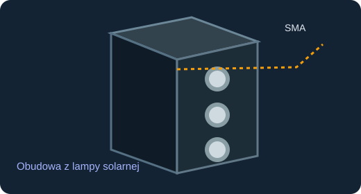
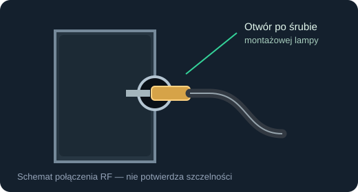

# Build gallery

## Actual prototype photos

 &nbsp; 

*Original user photographs from 16 November 2026, downscaled for repository display.*

The external antenna cable and SMA connector were routed through a **pre-existing wall-mount screw opening** in the reused solar-lamp enclosure. That avoids drilling an extra opening but does **not** certify the modified enclosure as waterproof.

Results and timestamps: [measurement log](measurements-en.md). Technical drawings are illustrative, while documented screenshots represent actual radio tests.
