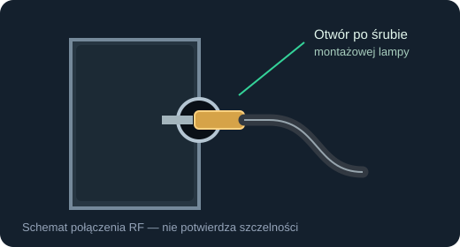

# Galeria — prototyp i detale montażu

## Prawdziwe zdjęcia

**Jeszcze nieopublikowane.** Folder `assets/images/` nie zawiera fotografii urządzenia. Zdjęcia z budowy były pokazywane w rozmowie, ale nie zostały zapisane w tym repozytorium.

Docelowo znajdą się tutaj ujęcia otwartej lampki, zbliżenie elektroniki i ogniwa 18650, przejście przewodu antenowego oraz zamknięty prototyp. Bez grafik udających rzeczywisty sprzęt.

## Rysunki poglądowe

Te ilustracje pomagają wyjaśnić pomysł, ale **nie pokazują faktycznego wyglądu ani jakości montażu**.

Przewód antenowy został poprowadzony przez istniejący otwór po śrubie mocującej lampę do ściany. Przejście wymaga jeszcze uszczelnienia i odciążenia mechanicznego.

## Test łączności

Dane z pomiarów i ich ograniczenia: [dziennik prób](measurements-pl.md).

*Stan dokumentacji: 16 listopada 2026. Sam wygląd obudowy nie potwierdza szczelności po przeróbce.*
