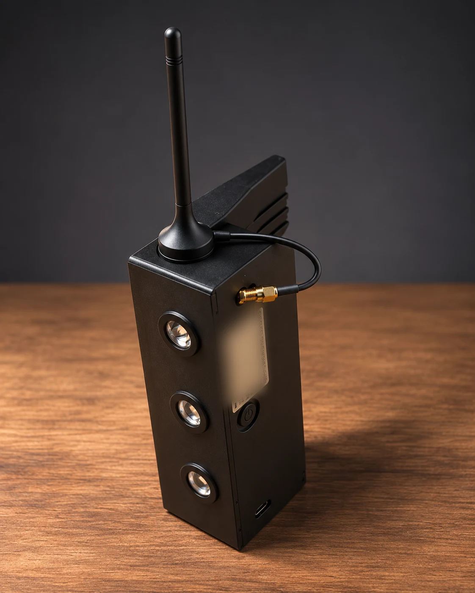
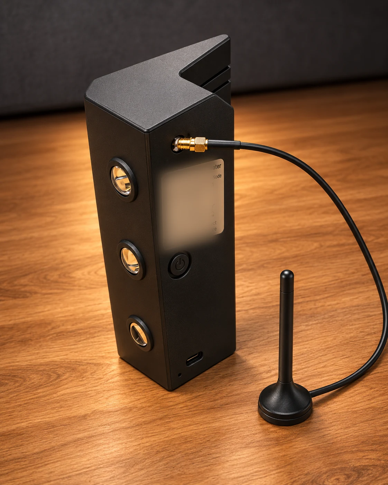
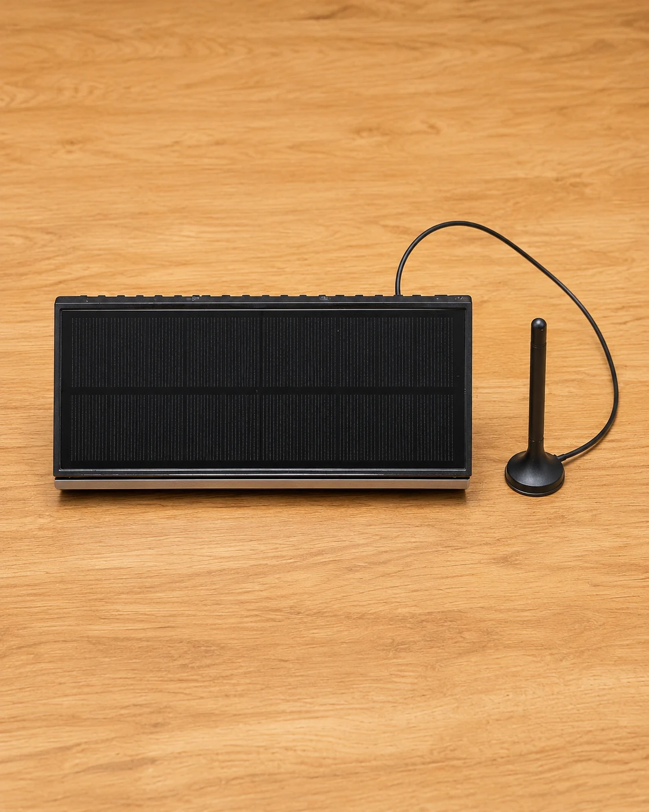
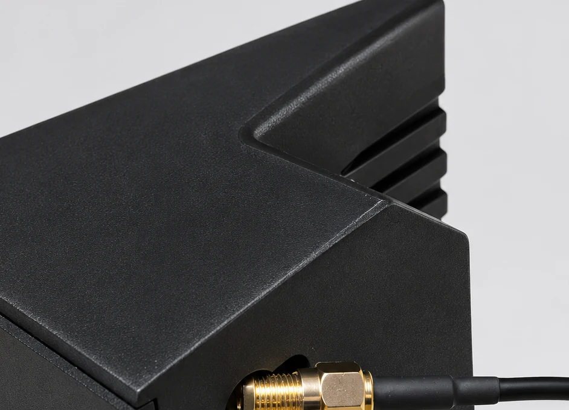
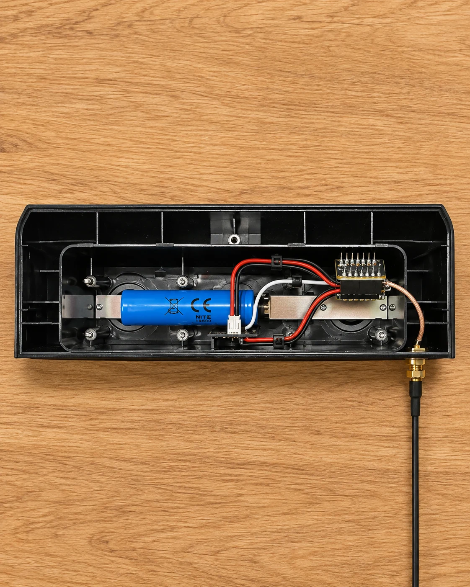

# Galeria

[← Strona główna](../README.md) · [English](gallery-en.md)

## Repeater

## Obudowa

## Panel i antena

## Detal złącza SMA

## Wnętrze

---

[Parametry i wyniki testów](measurements-pl.md) · [Opis konstrukcji](hardware-pl.md)
